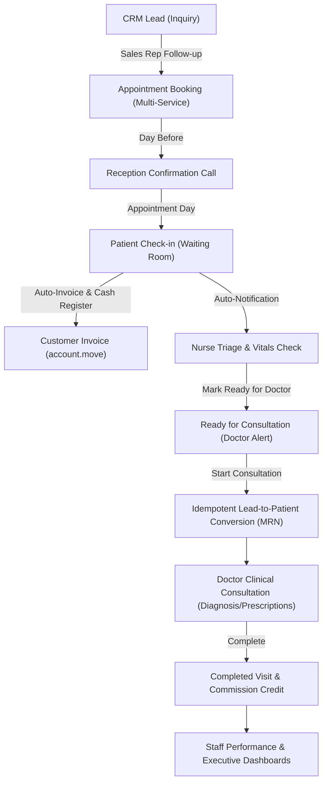

# Medical Center Management System — Complete Technical Blueprint & Recreation Guide (Odoo 18)

This document provides a comprehensive technical blueprint of the Medical Center Management System implemented in Odoo 18 (`medical_appointment_management` and `medical_employee_management`). Use this guide to recreate, deploy, or extend the solution in any environment.

---

## 1. System Overview & Architecture

The system provides an enterprise clinical operation and CRM pipeline tailored for medical clinics, polyclinics, and specialized centers. It connects the front-office sales workflow, reception desk, nursing triage, doctor clinical consultations, and executive management reporting.



---

## 2. Security Architecture & Role-Based Access Control (RBAC)

### 2.1. User Groups & Role Hierarchy Matrix

Configured in `custom_addons/medical_employee_management/security/medical_groups.xml` and `custom_addons/medical_appointment_management/security/appointment_groups.xml`:

| Role Level | XML Group ID | Permissions & Functional Boundary |
|---|---|---|
| **Owner / Full System Admin** | `base.group_system` & `group_medical_appointment_manager` | **Full unrestricted system visibility.** Full read/write/create/unlink across all appointments, clinical notes, leads, financial records, with supervisor conflict and scheduling overrides. |
| **Doctor Manager (Head of Doctors)** | `medical_employee_management.group_medical_doctor_manager` | Supervises clinical consultations for their team/department. Sees own appointments **plus all appointments of subordinate doctors** reporting to them (`doctor_id.parent_id` or `doctor_id.department_id.manager_id`). |
| **Regular Doctor** | `medical_employee_management.group_medical_doctor` | Sees and conducts **only their own** consultations and assigned appointments (`doctor_id.user_id = user.id`). Full access to Clinical Consultation tab. |
| **Nurse Manager (Head Nurse)** | `medical_employee_management.group_medical_nurse_manager` | Supervises nursing staff and triage queue across their team and clinic. Can oversee all triage assessments and vitals records. |
| **Regular Nurse** | `medical_employee_management.group_medical_nurse` | Access to triage queue and vital signs recording (BP, Temp, Pulse, SpO2, BMI). **Explicitly restricted from reading/writing doctor diagnoses, notes, and prescriptions.** |
| **Receptionist Manager (Head Receptionist)**| `medical_employee_management.group_medical_receptionist_manager` | Full oversight over front-desk reception, waiting room check-in, confirmation calls, and rescheduling. |
| **Regular Receptionist** | `medical_employee_management.group_medical_receptionist` | Receptionist dashboard, patient check-in, arrival invoices, and day-before confirmation call queue. |
| **Sales Manager (Head of Sales)** | `medical_employee_management.group_medical_sales_manager` | Supervises sales team. Sees own leads/appointments **plus all leads and bookings attributed to sales representatives reporting to them** (`parent_id` or `team_id`). |
| **Regular Sales Rep** | `medical_employee_management.group_medical_sales` | Sees only **their own assigned CRM leads** and booked appointments (`sales_employee_id.user_id = user.id`). Call logging and booking wizard. |

### 2.2. Clinical Tab View-Level Restriction
```xml
<!-- Doctor Clinical Consultation Tab restricted to Doctors and Managers -->
<page string="Clinical Consultation" name="clinical_consultation"
      groups="medical_employee_management.group_medical_doctor,medical_appointment_management.group_medical_appointment_manager,base.group_system">
    <group string="Clinical Diagnosis &amp; Findings">
        <field name="diagnosis" placeholder="Enter formal clinical diagnosis..."/>
        <field name="prescription" placeholder="Prescribed medications, dosage, and intake instructions..."/>
    </group>
    <group string="Treatment Plan &amp; Confidential Notes">
        <field name="treatment_plan" placeholder="Recommended treatment procedures and follow-up plan..."/>
        <field name="doctor_notes" placeholder="Confidential clinical observations..."/>
    </group>
</page>
```

---

## 3. Data Models & Field Specifications

### 3.1. `medical.appointment`
The central model orchestrating the multi-disciplinary clinic lifecycle.

```python
class MedicalAppointment(models.Model):
    _name = 'medical.appointment'
    _description = 'Medical Center Appointment'
    _order = 'appointment_date desc, start_time desc, id desc'
    _inherit = ['mail.thread', 'mail.activity.mixin']

    # Identity & Company
    name = fields.Char('Appointment Reference', required=True, copy=False, readonly=True, default=lambda self: _('New'))
    company_id = fields.Many2one('res.company', string='Company', default=lambda self: self.env.company, required=True)
    currency_id = fields.Many2one('res.currency', string='Currency', related='company_id.currency_id', readonly=True)

    # Patient & Provider
    partner_id = fields.Many2one('res.partner', string='Patient / Customer', required=True, tracking=True, index=True)
    partner_phone = fields.Char(related='partner_id.phone', readonly=True)
    partner_mobile = fields.Char(related='partner_id.mobile', readonly=True)
    patient_mrn = fields.Char(related='partner_id.patient_number', string='Patient MRN', readonly=True, index=True)
    patient_status = fields.Selection(related='partner_id.patient_status', readonly=True)
    is_patient = fields.Boolean(related='partner_id.is_patient', readonly=True)

    doctor_id = fields.Many2one('hr.employee', string='Doctor / Provider', required=True, domain="[('is_appointment_provider', '=', True)]", tracking=True, index=True)
    doctor_user_id = fields.Many2one('res.users', related='doctor_id.user_id', readonly=True)

    # Multi-Service Catalog
    service_ids = fields.Many2many('medical.service', 'medical_appointment_service_rel', 'appointment_id', 'service_id', string='Medical Services', tracking=True)
    service_id = fields.Many2one('medical.service', string='Primary Service', compute='_compute_service_id', inverse='_inverse_service_id', store=True, tracking=True)
    service_price = fields.Float('Total Services Price', compute='_compute_service_price', store=True, tracking=True)

    # Schedule, Float Times & Datetimes for Calendar
    appointment_date = fields.Date('Appointment Date', required=True, tracking=True, index=True)
    start_time = fields.Float('Start Time', required=True, tracking=True, help='Start time in hour fraction, e.g. 9.5 = 09:30')
    duration = fields.Float('Duration (Hours)', default=0.5, required=True, tracking=True)
    end_time = fields.Float('End Time', compute='_compute_end_time', store=True)
    allow_backdated_entry = fields.Boolean('Allow Past / Backdated Entry', default=False, tracking=True)

    appointment_datetime_start = fields.Datetime('Start Datetime', compute='_compute_appointment_datetimes', inverse='_inverse_appointment_datetime_start', store=True, index=True)
    appointment_datetime_end = fields.Datetime('End Datetime', compute='_compute_appointment_datetimes', inverse='_inverse_appointment_datetime_end', store=True, index=True)

    # Lifecycle Status
    status = fields.Selection([
        ('tentative', 'Tentative (Booked by Sales)'),
        ('confirmed', 'Confirmed (Reception)'),
        ('checked_in', 'Patient Arrived (Waiting Room)'),
        ('ready_for_doctor', 'Vitals Done (Ready for Doctor)'),
        ('in_consultation', 'In Consultation'),
        ('completed', 'Completed'),
        ('cancelled', 'Cancelled'),
        ('no_show', 'No-Show'),
    ], string='Status', default='tentative', required=True, tracking=True, index=True)

    # Reception Workflow
    confirmation_call_status = fields.Selection([
        ('pending', 'Pending Confirmation'),
        ('confirmed', 'Confirmed'),
        ('no_answer', 'Unable to Reach (No Answer)'),
        ('declined', 'Declined'),
        ('rescheduled', 'Rescheduling Required'),
    ], string='Confirmation Status', default='pending', tracking=True)
    confirmation_date = fields.Datetime('Confirmed On', readonly=True)
    confirmed_by_id = fields.Many2one('res.users', 'Confirmed By', readonly=True)
    check_in_time = fields.Datetime('Check-in Time', readonly=True)
    checked_in_by_id = fields.Many2one('res.users', 'Checked in By', readonly=True)

    # Nurse Triage
    nurse_id = fields.Many2one('hr.employee', domain="[('medical_employee_type', '=', 'nurse')]", tracking=True)
    nurse_check_time = fields.Datetime('Nurse Check Time', readonly=True)
    vital_blood_pressure = fields.Char('Blood Pressure (mmHg)')
    vital_temperature = fields.Float('Temperature (°C)')
    vital_heart_rate = fields.Integer('Heart Rate (bpm)')
    vital_respiratory_rate = fields.Integer('Resp. Rate (bpm)')
    vital_oxygen_saturation = fields.Float('SpO2 (%)')
    vital_weight = fields.Float('Weight (kg)')
    vital_height = fields.Float('Height (cm)')
    vital_bmi = fields.Float('BMI', compute='_compute_vital_bmi', store=True)
    nurse_notes = fields.Text('Nurse Triage Notes')

    # Doctor Clinical Records
    consultation_start_time = fields.Datetime('Consultation Started', readonly=True)
    diagnosis = fields.Text('Clinical Diagnosis & Findings')
    prescription = fields.Text('Prescription & Medications')
    treatment_plan = fields.Text('Treatment Plan & Clinical Notes')
    doctor_notes = fields.Text('Confidential Clinical Observations')

    # Sales & Commission
    sales_employee_id = fields.Many2one('hr.employee', domain="[('medical_employee_type', '!=', False)]", tracking=True)
    salesperson_id = fields.Many2one('res.users', tracking=True)
    commission_rate = fields.Float('Commission Rate (%)', default=5.0)
    commission_amount = fields.Float('Commission Amount', compute='_compute_commission_amount', store=True)

    # Invoicing & Accounting
    invoice_id = fields.Many2one('account.move', string='Customer Invoice', readonly=True, copy=False)
    invoice_status = fields.Selection([
        ('no', 'No Invoice'),
        ('draft', 'Draft Invoice'),
        ('posted', 'Invoiced (Unpaid)'),
        ('paid', 'Paid'),
    ], compute='_compute_invoice_status', store=True)
```

---

## 4. Key Business Logic & Algorithms

### 4.1. Concurrency Protection (PostgreSQL Advisory Locking)
To avoid race conditions and double bookings during simultaneous submissions, a transactional advisory lock is obtained on the doctor ID and appointment date:

```python
for vals in vals_list:
    doc_id = vals.get('doctor_id')
    apt_date = vals.get('appointment_date')
    if doc_id and apt_date:
        self.env.cr.execute(
            "SELECT pg_advisory_xact_lock(hashtext(concat('doc_sched_', %s, '_', %s)))",
            (doc_id, str(apt_date))
        )
```

### 4.2. Overlap Conflict Detection
Detects any active overlapping appointments for the same doctor, excluding cancelled ones:
$$\text{Overlap} \iff (\text{new\_start} < \text{existing\_end}) \land (\text{new\_end} > \text{existing\_start})$$

```python
def _detect_overlap_conflicts(self):
    self.ensure_one()
    if not self.doctor_id or not self.appointment_date or not self.duration:
        return False, ""

    apt_id = self._origin.id if hasattr(self, '_origin') and self._origin else (self.id or 0)
    other_apts = self.search([
        ('id', '!=', apt_id),
        ('doctor_id', '=', self.doctor_id.id),
        ('appointment_date', '=', self.appointment_date),
        ('status', '!=', 'cancelled'),
    ])

    conflicts = []
    for other in other_apts:
        if self.start_time < other.end_time and other.start_time < self.end_time:
            conflicts.append(_("%s with %s (%02d:%02d - %02d:%02d)") % (
                other.name, other.partner_id.name,
                int(other.start_time), int((other.start_time % 1) * 60),
                int(other.end_time), int((other.end_time % 1) * 60)
            ))
    if conflicts:
        return True, _("Overlaps with active booking(s):\n• ") + "\n• ".join(conflicts)
    return False, ""
```

### 4.3. Timezone-Aware Datetime Synchronization for Time-Grid Calendar
Converts floating start times (`10.5` = `10:30 AM`) in clinic local timezone into UTC `fields.Datetime` so Odoo renders the appointment in the hourly time-grid slots rather than the all-day header:

```python
@api.depends('appointment_date', 'start_time', 'duration', 'company_id')
def _compute_appointment_datetimes(self):
    for apt in self:
        if apt.appointment_date and apt.start_time is not False:
            tz = apt._get_medical_center_tz()
            hours = int(apt.start_time)
            minutes = int(round((apt.start_time - hours) * 60))
            if minutes >= 60:
                hours += 1
                minutes = 0
            hours = min(max(hours, 0), 23)
            minutes = min(max(minutes, 0), 59)
            local_start_dt = datetime.combine(apt.appointment_date, time(hour=hours, minute=minutes))
            try:
                localized_start = tz.localize(local_start_dt, is_dst=None)
            except Exception:
                localized_start = tz.localize(local_start_dt)

            utc_start = localized_start.astimezone(pytz.UTC).replace(tzinfo=None)
            apt.appointment_datetime_start = utc_start
            dur = apt.duration if apt.duration and apt.duration > 0 else 0.5
            apt.appointment_datetime_end = utc_start + timedelta(hours=dur)
        else:
            apt.appointment_datetime_start = False
            apt.appointment_datetime_end = False
```

### 4.4. Lead-to-Patient Conversion (`action_start_consultation`)
Transactional and duplicate-safe conversion triggered automatically when consultation starts:
1. Reuses existing patient if already linked.
2. Deduplicates against existing `res.partner` records matching phone, mobile, or email.
3. If no patient exists, creates patient, links CRM lead history, sets `is_patient = True`, and generates sequence number `MRN-YYYY-XXXX`.

---

## 5. UI Views & Dashboards

### 5.1. Calendar View (`view_medical_appointment_calendar`)
Configured to use datetime fields so appointments appear in their exact scheduled time slots:

```xml
<record id="view_medical_appointment_calendar" model="ir.ui.view">
    <field name="name">medical.appointment.calendar</field>
    <field name="model">medical.appointment</field>
    <field name="arch" type="xml">
        <calendar string="Doctor Appointments"
                  date_start="appointment_datetime_start"
                  date_stop="appointment_datetime_end"
                  date_delay="duration"
                  color="doctor_id"
                  mode="week"
                  scales="day,week,month"
                  event_open_popup="true"
                  quick_create="false">
            <field name="name"/>
            <field name="partner_id" string="Patient" avatar_field="avatar_128"/>
            <field name="doctor_id" avatar_field="avatar_128"/>
            <field name="service_ids" widget="many2many_tags"/>
            <field name="start_time" widget="float_time"/>
            <field name="end_time" widget="float_time"/>
            <field name="status" widget="badge"/>
        </calendar>
    </field>
</record>
```

### 5.2. Receptionist Dashboard (`medical.receptionist.dashboard`)
- **KPI Cards:** Today's Appointments, Tomorrow's Confirmations, Patients Waiting, Arrived In-Clinic, Reschedule Requests.
- **Queue Views:**
  - `action_medical_receptionist_today_appointments` (Today's visits with check-in button)
  - `action_medical_appointment_tomorrow_confirmations` (Tomorrow's confirmations queue with actions for Confirm, No Answer, Declined, Reschedule)

### 5.3. Manager Operational Dashboard (`medical.manager.dashboard`)
- **Executive KPI Cards:** Appointments Today, Completed Today, Patients Waiting, No-Shows, Confirmed Revenue Today.
- **Risk & Alert Counters:** Unconfirmed Tomorrow Bookings, Overdue Leads, Active Scheduling Conflicts.
- **Doctor Workload Table:** Real-time breakdown of bookings, completed consultations, and occupancy per doctor.

### 5.4. Sales Representative Workspace (`action_medical_sales_workspace`)
Filters on `crm.lead`:
- `New Leads` (not contacted)
- `Should Call Today` (`next_followup_date == today`)
- `Not Called` (`call_log_count == 0`)
- `Overdue Follow-up` (`is_overdue == True`)
- `Follow-up Due` (follow-up scheduled)
- `Converted` (`appointment_count > 0` or partner is patient)
- `Lost` (lost/archived)

---

## 6. Verification & Automated Test Suite

The module includes **48 automated unit tests** in `custom_addons/medical_appointment_management/tests/`:

| Test Suite File | Coverage |
|---|---|
| `test_role_based_dashboards_and_validation.py` | Time bounds, past appointment rejection, doctor hours & leaves, PostgreSQL advisory lock concurrency, auto-tasks, time-slotted calendar view. |
| `test_appointment_booking.py` | Multi-service booking, catalog pricing/duration sync, cash invoice generation, payment registration modal, scheduling conflicts. |
| `test_patient_management.py` | Lead-to-patient conversion, MRN sequence, duplicate prevention by phone/email, role-based field security. |
| `test_staff_performance_report.py` | Analytics report calculations, revenue attribution, conversion rates, Excel/PDF exports. |
| `test_call_logging.py` | Sales call log wizard, outcome logging, next follow-up scheduling, activity creation. |

### Running the Test Suite
```bash
./venv/bin/python odoo-bin -c odoo18.conf -d odoo2 --http-port=8079 \
    -u medical_appointment_management \
    --test-enable --stop-after-init \
    --test-tags /medical_appointment_management
```

---

## 7. Recreating or Deploying the Module from Scratch

### Step 1: Ensure Prerequisites
- Odoo 18 Community or Enterprise.
- Standard modules installed: `crm`, `hr`, `hr_holidays`, `account`, `mail`.

### Step 2: Add Custom Addons
Place the following modules in your `custom_addons/` path:
- `medical_employee_management`
- `medical_appointment_management`
- `muk_backend_theme` (optional UI enhancement)

### Step 3: Upgrade Database
```bash
./venv/bin/python odoo-bin -c odoo18.conf -d <your_db> -u medical_employee_management,medical_appointment_management
```

### Step 4: Initial Configuration
1. Open **Medical Center -> Configuration -> Settings**.
2. Verify default commission rate, allow backdated entries supervisor rights, and default consultation duration.
3. In **Employees**, configure medical employees (`medical_employee_type` set to Doctor, Nurse, Receptionist, or Sales) and link their user accounts.
4. Set `is_appointment_provider = True` for doctors and assign working calendars (`resource.calendar`).
5. In **Medical Services**, define medical catalog procedures, prices, and standard durations.
