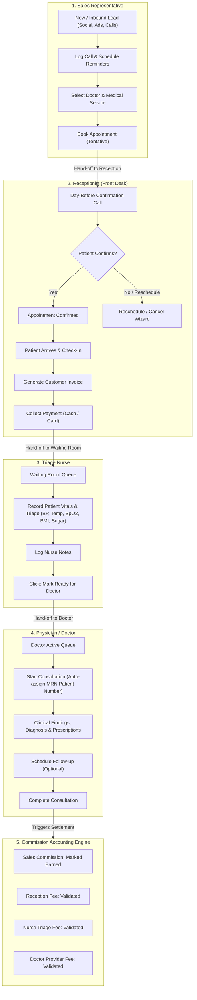

# Medical Center CRM & Clinical Appointment Role-Based Workflow Specification

## 1. Executive Summary

This document specifies the end-to-end, multi-disciplinary role-based CRM and Clinical Appointment lifecycle in **Odoo 18** for Medical Centers. 

The system coordinates four distinct operational roles across the patient journey:
1. **Sales Representative (Medical Sales Staff)**
2. **Receptionist (Front Desk Operations)**
3. **Triage Nurse (Clinical Preparation)**
4. **Physician / Doctor (Healthcare Provider)**

Each role operates on tailored CRM/Appointment views, has strictly enforced permissions, performs dedicated operational actions, hands off the record to the next phase upon completion, and participates in an automated commission and performance accounting model.

---

## 2. High-Level Process Flow



---

## 3. Detailed Role Specifications

### 3.1. Role 1: Medical Sales Representative (`group_medical_sales`)

#### Scope & Views
- **Default CRM Filter**: 
  - `My Active Leads`: Leads assigned to the logged-in user.
  - `New Unassigned Leads`: Fresh incoming leads from Facebook, Instagram, WhatsApp, Website, and Google Ads.
- **Access Level**: Full read and write on assigned leads; restricted from modifying clinical diagnostic fields or altering medical appointments once confirmed.

#### Core Actions
1. **Sales Call Logging (`crm.lead.call.log`)**:
   - Structured outcomes: *Interested, Callback Requested, Busy / No Answer, Wrong Number, Not Interested, Booked*.
   - Call duration tracking, discussion notes, and automatic next-activity creation.
2. **Attribution Preservation**:
   - Preserves source type (*Paid, Organic, Referral, Direct*), platform (*Facebook, Instagram, WhatsApp, etc.*), campaign name, and advertisement name.
3. **Appointment Booking (`appointment.from.lead.wizard`)**:
   - Selects qualified Doctor, requested Medical Services, appointment date, and time slot.
   - Real-time schedule conflict engine prevents overlapping bookings.

#### Hand-off Trigger & Completion
- **Completion Event**: Sales representative clicks **"Book Appointment"**.
- **Hand-off**: The CRM Lead state transitions to `Won`/`Booked`, creating a linked `medical.appointment` with `status = 'tentative'`.
- **Commission Rule**:
  - Commission rate (e.g., 5% of service total) is computed on the appointment (`commission_amount`).
  - Commission status is set to `pending`.
  - Sales representative's active task is **Finished**.

---

### 3.2. Role 2: Receptionist (`group_medical_receptionist`)

#### Scope & Views
- **Default Dashboards & Filters**:
  - `Tomorrow's Confirmations Queue`: Appointments scheduled for the next calendar day requiring confirmation calls.
  - `Today's Patient Visits`: Expected arrivals for today.
  - `Pending Arrival & Payment`: Patients waiting for invoice generation and settlement.
- **Access Level**: Can confirm, check-in, reschedule, cancel, and invoice appointments. Clinical records (prescriptions, diagnosis) remain read-only.

#### Core Actions
1. **Day-Before Confirmation Calls**:
   - Updates `confirmation_call_status`: *Confirmed*, *Unable to Reach (No Answer)*, *Declined*, or *Rescheduling Required*.
   - Confirmed bookings transition appointment status to `confirmed`.
2. **Patient Arrival Check-In (`action_check_in`)**:
   - When the patient arrives at the clinic, the receptionist clicks **"Patient Arrived (Check-In)"**.
   - Appointment status updates to `checked_in`.
   - Automatic activity notification is dispatched to the clinical triage queue and assigned doctor.
3. **Rescheduling / Cancellation / No-Show**:
   - **Reschedule Wizard (`appointment.reschedule.wizard`)**: Reallocates doctor, date, or time slot while maintaining conflict validation.
   - **Cancel Wizard (`medical.appointment.cancel.wizard`)**: Mandatory justification reason; releases doctor calendar slot.
   - **Mark No-Show (`action_no_show`)**: Sets status to `no_show` and cancels linked pending commissions.
4. **Billing & Invoicing**:
   - Generates and validates customer invoice (`action_create_invoice`).
   - 1-Click Instant Cash Settlement (`action_pay_cash_direct`) or opens payment register wizard (`action_pay_invoice`).

#### Hand-off Trigger & Completion
- **Completion Event**: Patient is checked in and invoice is generated/settled.
- **Hand-off**: Patient moves to the Waiting Room; appointment status becomes available for Nurse Triage.
- **Commission Rule**:
  - Front-desk handling/booking fee is registered.
  - Receptionist hand-off is **Finished**.

---

### 3.3. Role 3: Triage Nurse (`group_medical_nurse`)

#### Scope & Views
- **Default Queue**:
  - `Waiting Room & Nurse Triage`: Shows patients in `checked_in` status waiting for preliminary clinical intake.
- **Access Level**: Full write access to vitals and triage notes; read-only on administrative billing and sales attribution fields.

#### Core Actions
1. **Patient Vitals & Biometrics Recording**:
   - **Blood Pressure** (`vital_blood_pressure`): mmHg (Systolic/Diastolic).
   - **Body Temperature** (`vital_temperature`): °C.
   - **Heart Rate** (`vital_heart_rate`): bpm.
   - **Respiratory Rate** (`vital_respiratory_rate`): bpm.
   - **Oxygen Saturation** (`vital_oxygen_saturation`): SpO2 %.
   - **Height & Weight** (`vital_height`, `vital_weight`): Automated Body Mass Index (`vital_bmi`) computation.
   - **Blood Sugar** (`vital_blood_sugar`): mg/dL.
2. **Clinical Triage Notes (`nurse_notes`)**:
   - Documenting presenting symptoms, patient readiness, and immediate nursing observations.
3. **Reschedule Coordination**:
   - If vitals indicate severe contraindications (e.g., hyper-crisis, fever before elective surgery), nurse can request rescheduling.

#### Hand-off Trigger & Completion
- **Completion Event**: Nurse clicks **"Mark Ready for Doctor"** (`action_ready_for_doctor`).
- **Hand-off**: Appointment status updates to `ready_for_doctor`. An urgent activity alert is generated for the assigned doctor.
- **Commission Rule**:
  - Nurse triage procedure fee is logged.
  - Nurse intake role is **Finished**.

---

### 3.4. Role 4: Physician / Doctor (`group_medical_doctor`)

#### Scope & Views
- **Default Queue**:
  - `Doctor Consultation Queue`: Shows patients in `ready_for_doctor` and `in_consultation` status assigned to the logged-in doctor.
- **Access Level**: Full write access to clinical examination, diagnosis, prescriptions, and follow-up plans.

#### Core Actions
1. **Start Consultation (`action_start_consultation`)**:
   - Transitions appointment status to `in_consultation`.
   - **Automated Lead-to-Patient Conversion**:
     - Automatically registers a formal Medical Patient record in `res.partner`.
     - Allocates a unique Medical Record Number (**MRN**, sequence `medical.patient.mrn`).
     - Links previous visit history and retains complete source attribution.
2. **Clinical Treatment Documentation**:
   - **Diagnosis & Clinical Findings** (`diagnosis`).
   - **Prescription & Medications** (`prescription`).
   - **Treatment Plan & Clinical Notes** (`treatment_plan`).
   - **Confidential Observations** (`doctor_notes`).
3. **Patient History Review (`action_view_patient_history`)**:
   - 1-click access to historical visits, past vital trends, and previous prescriptions.
4. **Follow-Up Scheduling (`action_create_followup`)**:
   - Automatically computes next visit date based on configured service interval periods (`period_between_sessions`).
5. **Complete Consultation (`action_complete`)**:
   - Marks the clinical consultation as finalized (`status = 'completed'`).

#### Hand-off Trigger & Completion
- **Completion Event**: Doctor clicks **"Complete Consultation"**.
- **Hand-off**: Appointment lifecycle terminates in `completed` state. Clinical documentation is locked for compliance.
- **Commission Rule**:
  - Doctor provider fee/commission is finalized.
  - Releases and validates all linked role commissions (Sales, Reception, Nurse, Doctor).
  - Doctor consultation role is **Finished**.

---

## 4. Commission Matrix & Lifecycle Accounting

| Role | Operational Trigger | Status on Trigger | Settlement Condition | Status on Cancellation / No-Show |
| :--- | :--- | :--- | :--- | :--- |
| **Sales Representative** | Appointment Booked from Lead | `pending` | Consultation Completed by Doctor | `cancelled` (Forfeited) |
| **Receptionist** | Patient Arrival Check-In & Payment | `pending` | Consultation Started / Completed | `cancelled` (Forfeited) |
| **Triage Nurse** | Vitals Recorded & Marked "Ready for Doctor" | `pending` | Consultation Completed by Doctor | `cancelled` (Forfeited) |
| **Physician / Doctor** | Consultation Completed | `earned` | Consultation Finalized & Signed Off | `cancelled` (Forfeited) |

---

## 5. Security & Domain Rules Reference

### 5.1. CRM Leads (`crm.lead`)
- **Sales Staff**:
  ```python
  ['|', ('user_id', '=', user.id), ('user_id', '=', False)]
  ```
- **Receptionist / Nurse / Doctor**:
  ```python
  [(1, '=', 1)]  # Read-only access for medical context and patient history
  ```

### 5.2. Appointments (`medical.appointment`)
- **Sales Staff**:
  - Can view all appointments; can edit only appointments where they are the credited salesperson and status is `tentative`.
- **Receptionist**:
  - Can view all appointments; can edit `tentative` and `confirmed` bookings for confirmation, scheduling, check-in, and billing.
- **Nurse**:
  - Can view checked-in patients; can edit triage and vitals fields until marked `ready_for_doctor`.
- **Doctor**:
  - Can view all clinic appointments; can edit clinical diagnosis and complete visits only for appointments where `doctor_id.user_id = user.id`.

---

## 6. Verification & Implementation Checklist

- [x] **Sales Role Call Wizard**: Available on CRM leads with direct outcome logging.
- [x] **Appointment Booking Wizard**: Carries lead attribution, checks doctor calendar conflicts.
- [x] **Reception Daily Dashboard**: Day-before confirmation queue and today's visits list.
- [x] **1-Click Check-in & Invoicing**: Automatic invoice creation and cash register integration.
- [x] **Nurse Triage Queue**: Automatic BMI calculation and vitals validation.
- [x] **Automated MRN Generation**: Idempotent patient creation upon consultation initiation.
- [x] **Status Audit Trail**: Every status transition logged with timestamp, user ID, and justification reason.
- [x] **Commission Settlement**: Status changes to `earned` on `action_complete` and `cancelled` on `action_no_show` or `action_cancel`.
